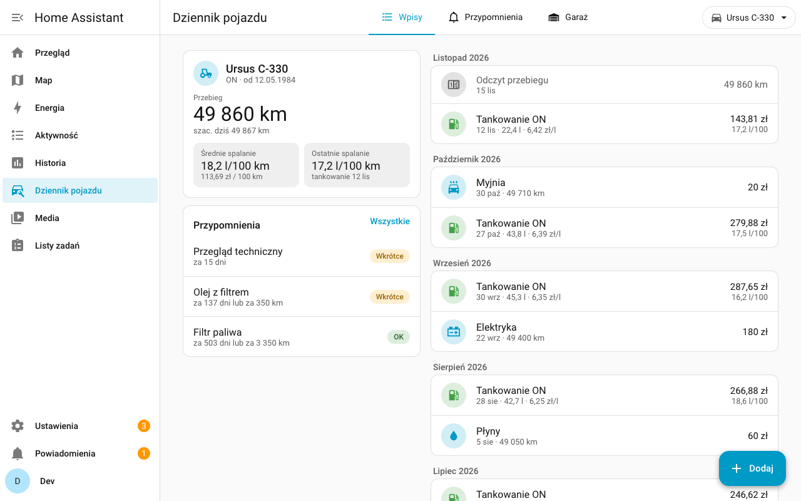
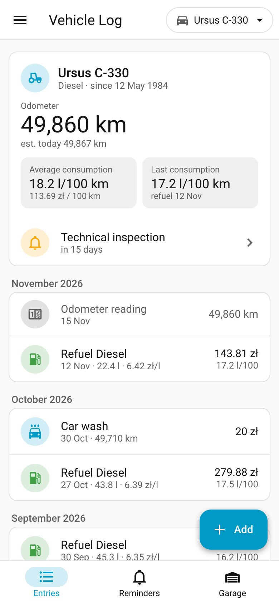
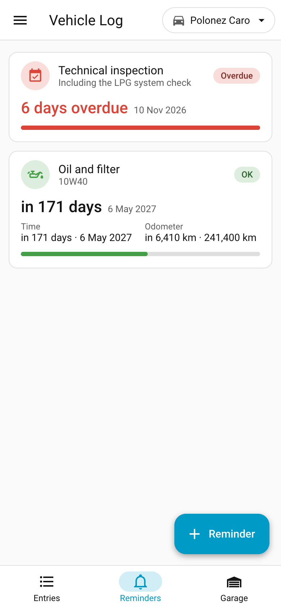
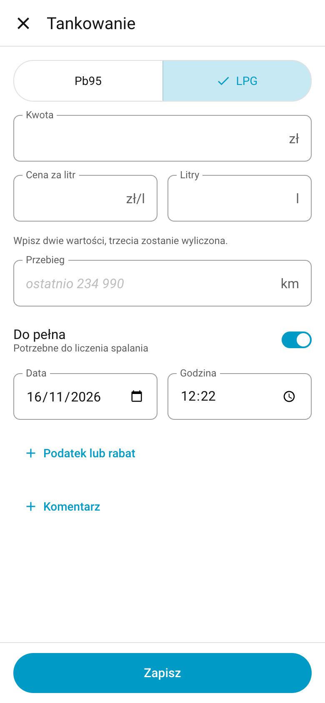
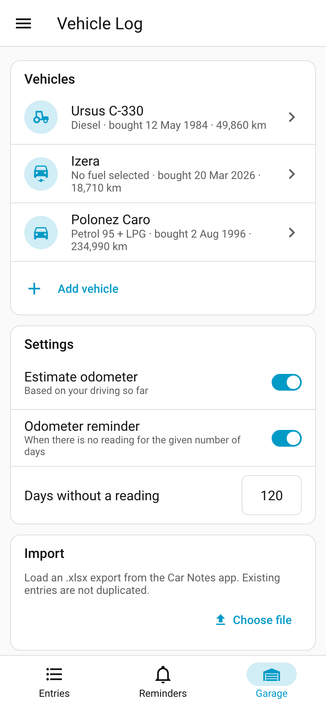

# Vehicle Log

A car service journal for Home Assistant, with its own sidebar panel.

Keep a log of service entries, refuels and odometer readings for one or more vehicles. Set reminders by date and/or mileage and get notified when they are due. Everything is stored locally in Home Assistant; no cloud, no account.

## Screenshots

The sample data below is made up (an Ursus C-330 tractor, an Izera and a Polonez Caro).



| Entries | Reminders | Refuel form | Garage |
| :---: | :---: | :---: | :---: |
|  |  |  |  |

## Features

- Several vehicles, each with its own odometer, entries and reminders, and one or two fuel types (e.g. Pb95 + LPG). The refuel form offers only that vehicle's fuels.
- Service entries (oil, filters, brakes, tyres, ...), refuels and odometer updates.
- Fuel consumption (L/100 km) calculated from full-tank refuels, per fuel.
- LPG savings: how much driving on LPG saves compared with petrol, and when the installation pays for itself (see below).
- Reminders by date, mileage or both (for example "every 12 months or 10 000 km"), with ready-made templates.
- Forecast odometer based on your driving history, so mileage-based reminders can warn you in advance.
- Home Assistant sensors, a persistent notification and an event for every due item.
- Import of vehicles, service entries and odometer readings from a Car Notes Excel export (see below).

## Installation (HACS)

1. In HACS open the three-dot menu, then **Custom repositories**.
2. Add `https://github.com/pawcionaprawcio/ha-vehicle-log` with category **Integration**.
3. Install **Vehicle Log** and restart Home Assistant.
4. Go to **Settings > Devices & services > Add integration** and add **Vehicle Log**. No configuration is needed; only one instance is allowed.

A **Vehicle Log** entry appears in the sidebar. The panel has three tabs: entries, reminders and garage (vehicles, settings and import).

The panel follows the look of Home Assistant's own Settings pages and adapts to the active theme (light, dark or a custom one):

- A top bar with a vehicle picker, the tabs **Entries**, **Reminders** and **Garage** (a bottom bar on phones), and a menu button.
- **Entries**: a summary card with odometer and consumption, then entries grouped by month as list rows with round icon badges. Add service entries, refuels and odometer readings from the floating action button.
- **Reminders**: cards with a coloured status chip (on time, soon, overdue), the nearest limit in large text and a progress bar. Tap a card for details.
- **Garage**: vehicles, settings switches and the import.
- Forms open as full-screen sheets on a phone, so refuels can be entered at the pump from the Companion app.

### Language

The panel is in English or Polish. It follows the language set in your Home Assistant user profile: Polish when that is Polish, English for every other language. The sidebar title and the notifications follow the server language (**Settings > System > General**) the same way. Service type names are translated too, but the names and texts you save (entries, reminders) are kept as entered. Amounts are shown in złoty.

## Importing from Car Notes

The garage tab can import the `.xlsx` file exported by the Car Notes Android app (vehicles, with their service entries and odometer readings; each vehicle's purchase date is taken when present). Refuels and reminders are not imported: log refuels in the panel and re-create reminders in the Reminders tab. Choose the file in the garage tab and confirm. This integration is an independent project and is not affiliated with or endorsed by the Car Notes app or its authors.

## LPG savings

For a car converted to LPG:

1. In the garage, set the vehicle's petrol consumption ("Spalanie Pb", l/100 km). It is used until the panel has measured it from your refuels (at least 1000 km of petrol-only driving).
2. Add a service entry of type "Montaż instalacji LPG" (LPG installation) with the odometer reading and the cost. Savings are counted from that odometer reading. If the vehicle has fewer than two fuels, LPG is added to its fuels. Later LPG service entries ("Serwis LPG") count as LPG costs too.
3. On LPG refuels you can enter the current petrol price; when it is empty, the last known petrol price is used.
4. On a petrol refuel after the installation, switch on "only petrol since the last petrol refuel" when that is true, so the refuel counts towards the measured petrol consumption.

The vehicle card in the entries tab shows the total saved and, when the LPG costs are known, the payback progress, the amount still to pay back and a forecast odometer and month. Next to the petrol consumption, a "Driving on LPG" tile shows litres of LPG plus litres of petrol per 100 km while running on LPG (the engine starts and warms up on petrol). It spans the first to the last full LPG refuel after the installation, leaves out stretches marked as petrol only, and appears after at least 500 km. It is approximate, because the tank levels between refuels are not known.

## Settings

Available in the garage tab:

| Setting | Default | Meaning |
|---|---|---|
| Forecast odometer | on | Estimate the current mileage from the history, used for mileage reminders. |
| Odometer update reminder | on | Notify when no odometer reading was logged for a while. |
| Days without a reading | 120 | How long to wait before the odometer reminder. |

## Entities

Per vehicle (the vehicle is a device; entity ids follow the device name, e.g. `sensor.my_car_odometer`):

| Entity | Type | Description |
|---|---|---|
| Odometer | sensor, km | Latest known odometer reading. |
| Forecast odometer | sensor, km | Estimated current mileage. |
| Fuel consumption | sensor, L/100km | Last full-tank segment; attributes `avg_l_per_100km`, `avg_cost_per_100km`. |
| Odometer update due | binary sensor (problem) | On when an odometer reading is overdue. |
| LPG savings | sensor, currency | Fuel savings minus LPG installation and service costs; attributes include `lpg_l_per_100km` and `petrol_on_lpg_l_per_100km` (consumption while driving on LPG). Only for vehicles with an LPG installation entry. |
| LPG payback | sensor, % | How much of the LPG costs the savings have paid back; attributes `remaining`, `paid_back`, `payback_odometer`, `payback_month`. Only when the LPG costs are known. |

Per reminder:

| Entity | Type | Description |
|---|---|---|
| `<reminder>` remaining distance | sensor, km | Kilometres left until due. |
| `<reminder>` remaining days | sensor, days | Days left until due. |
| `<reminder>` progress | sensor, % | How much of the interval is used. |
| `<reminder>` due | binary sensor (problem) | On when due; attributes `due_date`, `due_odometer`. |

Entities are created and removed automatically as you add or delete vehicles and reminders.

## Notifications and the `vehicle_log_reminder_due` event

When a reminder (or an overdue odometer update) becomes due, Vehicle Log creates a persistent notification and fires the event `vehicle_log_reminder_due` once. It is checked whenever data changes and every day at 09:00.

Event data:

| Field | Reminder | Odometer update | Notes |
|---|---|---|---|
| `kind` | `reminder` | `odometer` | |
| `vehicle_id` | yes | yes | |
| `vehicle_name` | yes | yes | |
| `reminder_id` | yes | - | |
| `text` | yes | - | Reminder text. |
| `due_date` | yes | - | ISO date or null. |
| `due_odometer` | yes | - | km or null. |
| `last_date` | - | yes | Date of the last odometer entry. |

### Example: push notification to your phone

```yaml
automation:
  - alias: "Vehicle Log: reminder due"
    triggers:
      - trigger: event
        event_type: vehicle_log_reminder_due
        event_data:
          kind: reminder
    actions:
      - action: notify.mobile_app_your_phone
        data:
          title: "{{ trigger.event.data.vehicle_name }}"
          message: >-
            {{ trigger.event.data.text }}
            (by {{ trigger.event.data.due_date }})
            (at {{ trigger.event.data.due_odometer }} km)
```

Replace `notify.mobile_app_your_phone` with your own notify service. To also handle odometer reminders, drop the `event_data` filter and use `kind` in a template.

## Development

```bash
uv sync
uv run pytest -q
```

CI runs hassfest, the HACS validation and the test suite.

## License

MIT, see [LICENSE](LICENSE).
